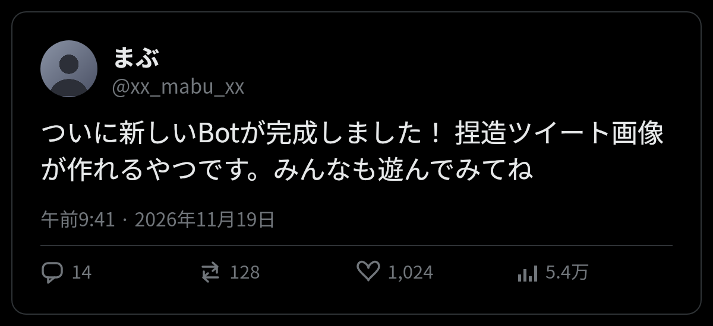

# Fake Tweet Bot

| 項目 | 内容 |
|---|---|
| バージョン | 1.0.0 |
| 状態 | 稼働中 |
| 稼働先 | 台3 minase（pm2） |
| 実装 | TypeScript / discord.js v14 / @napi-rs/canvas |

Discord のメッセージや任意のテキストから、**ツイート風の画像**を生成する Bot です。
X（旧 Twitter）のダークモードのツイート表示に寄せたカード画像を作ります。
言っていないことを言ったことにする、お遊び用の捏造画像ジェネレータで、
名言画像を作る Make It a Quote Bot の兄弟プロジェクトです。



📜 更新履歴: [CHANGELOG.md](CHANGELOG.md) / 🛠️ 設計: [DESIGN.md](DESIGN.md)

## ✨ 機能

入口は2つあります。

- **メッセージの右クリック → アプリ →「Fake Tweet」**
  実際の発言を、そのままツイート風画像にします。発言者のアバター・表示名・
  @ユーザー名と、メッセージの日時が入ります。
- **`/tweet`**
  指定したユーザーが投稿したことにして、任意のテキストでツイート画像を
  捏造します。いいね数とリツイート数はオプションで指定できます
  （省略時は控えめな固定値）。日時は実行した時刻になります。

生成画像は幅 1200px の PNG で、高さは本文の量に応じて変わります。
アバター画像を取得できないユーザーは、名前の頭文字の代替画像になります。

生成した画像は不適切な使用がないか確認できるよう、Bot のサーバー内
（`data/archive/`）に自動保存されます。`index.jsonl` に日時・作成者・
対象ユーザー・本文が記録され、保持は最大30日／最大1000件（古い順に自動削除）。
この保存先は運営者だけが見られます。止める場合は環境変数 `PRODUCT_ARCHIVE=off`。

## 📋 コマンド

| コマンド | 種別 | 説明 |
|---|---|---|
| `Fake Tweet` | メッセージのコンテキストメニュー | 対象メッセージの実発言をツイート風画像にする |
| `/tweet` | スラッシュコマンド | 指定ユーザーの投稿として任意テキストのツイート風画像を捏造する |

`/tweet` のオプション:

| オプション | 必須 | 説明 |
|---|---|---|
| `user` | ○ | 投稿者にするユーザー |
| `text` | ○ | 投稿したことにするテキスト（最大300文字） |
| `likes` | － | いいね数（0〜999,999,999。省略時は固定値 37） |
| `retweets` | － | リツイート数（0〜999,999,999。省略時は固定値 9） |

## 🔧 環境変数

| 変数 | 必須 | 説明 |
|---|---|---|
| `DISCORD_TOKEN` | ○ | Bot のトークン |
| `CLIENT_ID` | ○ | アプリケーションの Application ID |
| `GUILD_ID` | － | 設定するとそのサーバーだけにコマンドを即時登録。空ならグローバル登録（反映まで最大1時間） |
| `PRODUCT_ARCHIVE` | － | `off` / `false` / `0` で生成画像のアーカイブ保存を無効化 |
| `PRODUCT_ARCHIVE_DIR` | － | アーカイブ保存先（既定 `data/archive`） |

## 🚀 セットアップ

### 1. Discord アプリを作成する

[Discord Developer Portal](https://discord.com/developers/applications) で
アプリケーションを新規作成し、以下を控えます。

- **Bot** ページ: Bot ユーザーを作成し、トークンをリセットして取得する
  （これが `DISCORD_TOKEN`）。特権 Intent（Privileged Gateway Intents）は
  **すべて不要**です。有効化しないでください。
- **General Information** ページ: Application ID を控える（これが `CLIENT_ID`）。

### 2. Bot をサーバーに招待する

**OAuth2 → URL Generator** で以下を選び、生成された URL から招待します。

- Scopes: `bot` と `applications.commands`
- Bot Permissions: `Send Messages`、`Attach Files`（どちらも画像を返すため）

### 3. 設定ファイルを置く

`.env.example` を `.env` にコピーして埋めます。まず試す場合は
`GUILD_ID` の設定がおすすめです（コマンドが即時反映されます）。

### 4. 起動する

Node.js 20 以上が必要です。

```bash
npm install
npm start
```

起動時にコマンドは自動登録されます（登録だけ先に行う場合は `npm run deploy`）。

## 🔄 pm2 での常駐

```bash
pm2 start ecosystem.config.cjs
pm2 startup   # 表示されたコマンドを実行
pm2 save
```

## 🧪 開発

```bash
npm test          # ビルド + 単体テスト（折り返し・禁則処理・フォーマット・レンダラ等）
npm run sample    # Discord に接続せず docs/sample.png を生成
./build.sh        # 依存解決→ビルド→テストを一括実行（Windows は build.bat）
```

開発手順は [CONTRIBUTING.md](CONTRIBUTING.md) の統一フローに従います。

## 📐 仕様メモ

- 描画は `@napi-rs/canvas`、フォントは `assets/fonts/` の Noto Sans JP
  （Regular / Bold、いずれも SIL Open Font License）を同梱して使うため、
  実行環境のフォントに依存しません。
- カードは X ダークモード風: 背景 `#000000`、境界線 `#2f3336` の角丸カード、
  丸く切り抜いたアバター、太字の表示名、灰色の @ユーザー名・時刻・カウント。
- カウント（返信 / リツイート / いいね / 表示数）は 1万以上で「万」表記に
  丸めるなど、日本語の X 表示に寄せた表記にしています。
- 日本語の折り返しには簡易な禁則処理（行頭禁則・行末禁則）を入れています。
  本文が長い場合は最大12行で切り捨て、末尾に … を付けます。
- Bot が必要とする権限は、メッセージ送信とファイル添付だけです。
  メッセージ内容を読む特権 Intent は使いません（右クリックの対象メッセージは
  Discord から直接渡されます）。
- 連打・同時多発対策として、ユーザー単位で10秒のクールダウンと
  同時生成数2件の上限を入口で設けています。

## ⚠️ 注意

捏造画像は身内で笑える範囲のお遊びに使ってください。本人が言っていないことを
本当に言ったかのように見せて、誤解やトラブルを招く使い方は避けてください。
実在の人物の発言を装った画像を、冗談と分からない形で拡散してはいけません。
